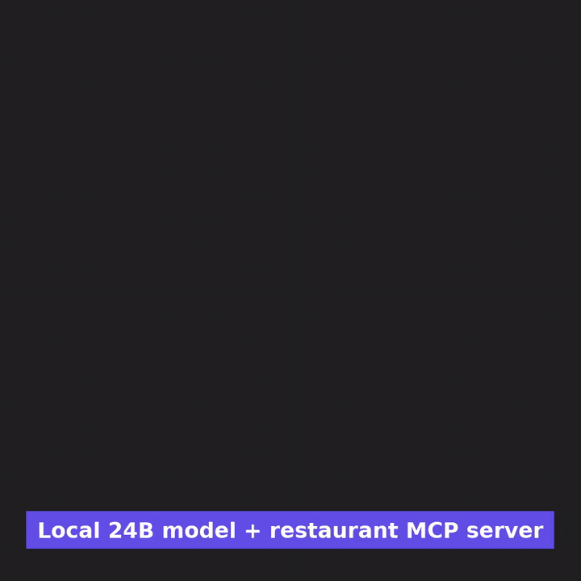

# Restaurant MCP Server

[](https://github.com/serdarpolat/restaurant-mcp-server/actions/workflows/ci.yml)


[](https://www.linkedin.com/in/serdar-polat-40287911b/)

> Connect AI assistants (Claude, etc.) to a realistic restaurant POS system through the
> [Model Context Protocol](https://modelcontextprotocol.io).

Ask your AI assistant things like:

- "What were our best-selling items today?"
- "Which ingredients are running low, and why is the minced meat almost gone?"
- "Add 2 Adana kebabs and 2 ayran to a free table." (it asks for the spice level)
- "Cancel that order." (it asks *you* to approve first)

<p align="center">
  
  <br>
  <sub>Running fully locally: LM Studio + magistral-small-2509, sped up.</sub>
</p>

> [!WARNING]
> **Work in progress: demo data only.** This project runs on generated data for a fictional
> restaurant. It is not connected to any real POS system, the API has no authentication, and
> it is not ready for real restaurants or real money. Run it on your own computer and do not
> expose the API or the HTTP MCP endpoint to a network. Connecting a real POS (behind
> authentication, read-only first) is planned but not built yet.

## Try it in 2 minutes

Pick one. Each option creates its own demo database (90 days of realistic sales) on first
start, which takes about 15 seconds. The demo data is regenerated when it is more than a day
old, so "today" always has sales.

### Option 1: Claude Desktop, zero setup (recommended)

Needs only [uv](https://docs.astral.sh/uv/getting-started/installation/) and git. Add this to
`claude_desktop_config.json` (Windows: `%APPDATA%\Claude\`, macOS:
`~/Library/Application Support/Claude/`) and restart Claude Desktop:

```json
{
  "mcpServers": {
    "restaurant-pos": {
      "command": "uvx",
      "args": [
        "--from",
        "git+https://github.com/serdarpolat/restaurant-mcp-server",
        "restaurant-pos-mcp"
      ]
    }
  }
}
```

No API to start: in this mode the POS API runs embedded inside the MCP server process.

### Option 2: LM Studio, fully local and free

Run everything on your own computer: no API key, no account, and the restaurant data never
leaves your machine. This is the setup the [evals](#evals-does-the-model-pick-the-right-tool)
were run with.

**You need**

- [LM Studio](https://lmstudio.ai) 0.3.17 or newer (the first version that can use MCP servers)
- [uv](https://docs.astral.sh/uv/getting-started/installation/) and
  [git](https://git-scm.com/downloads), as in option 1
- A model that supports tool calling. Tested with **Mistral Magistral Small 2509** (24B,
  Q4_K_M, about 14 GB). Smaller tool-calling models also work but make more mistakes;
  you can measure any model with the eval.

**Steps**

1. Install uv (Windows PowerShell; for macOS/Linux see the uv link above):

   ```powershell
   powershell -ExecutionPolicy ByPass -c "irm https://astral.sh/uv/install.ps1 | iex"
   ```

2. In LM Studio, search for and download the model (for example `magistral-small-2509`).
3. Load it with a context length of **16k or more**. The 20 tool descriptions alone take
   several thousand tokens, and a short context makes the model forget the tools.
4. Open the **Program** tab, choose **Install > Edit mcp.json**, and add
   the server. The file uses the same format as Claude Desktop's config:

   ```json
   {
     "mcpServers": {
       "restaurant-pos": {
         "command": "uvx",
         "args": [
           "--from",
           "git+https://github.com/serdarpolat/restaurant-mcp-server",
           "restaurant-pos-mcp"
         ]
       }
     }
   }
   ```

   If the file already lists other servers, add only the `"restaurant-pos"` entry inside
   `mcpServers`. The file lives at `%USERPROFILE%\.lmstudio\mcp.json` on Windows and
   `~/.lmstudio/mcp.json` on macOS and Linux.
5. Save. LM Studio starts the server by itself; the first start downloads the code and builds
   the demo data, which takes about 15 seconds. `restaurant-pos` should now appear under
   **Program** with its tools.
6. Start a new chat and turn the server on for it: click the hammer icon under the message
   box and pick `restaurant-pos`. It then shows as a chip next to the icon. Servers are
   switched on per chat. Then ask, in Turkish or English:
   - "Bugün en çok satan 5 ürün ne?" (What are today's top 5 items?)
   - "Salon 3'e 2 Adana aç." (Open an order of 2 Adana kebabs for table Salon 3.)
     It should ask for the spice level first.

**What you will see**

- LM Studio asks your permission before the model uses the server's tools. Each tool call
  appears in the chat; click it to see the arguments and the server's answer.
- Cancelling, voiding, taking payment and adding stock need a second approval, from the
  server itself. LM Studio has no approval window for this, so it happens in the chat: the
  first call changes nothing and returns a preview, the model shows it to you
  ("Sipariş #9349 ... iptal edilecek. Onaylıyor musunuz?"), and only after you say yes does
  it call again with the one-time token from the preview.

**If it does not work**

- *The model answers without calling any tool:* check that `restaurant-pos` is switched on
  for this chat (step 6) and that the model supports tool calling (the model's page in LM
  Studio says so).
- *The model says it is "an AI for something else":* a system prompt from an earlier use is
  still set for the chat. Clear the System Prompt field in the chat settings and start a
  new chat.
- *The server does not start:* run `uvx --version` and `git --version` in a terminal. If
  either is not found, install it and restart LM Studio.
- *The model loops or forgets what it was doing:* raise the context length and reload the
  model.

### Option 3: Docker

```bash
git clone https://github.com/serdarpolat/restaurant-mcp-server
cd restaurant-mcp-server
docker compose up
```

- POS API with interactive docs: http://localhost:8000/docs
- MCP server over Streamable HTTP: http://localhost:8001/mcp

Both ports listen on your own computer only (`127.0.0.1`), since the demo has no
authentication.

### Option 4: From source

```bash
git clone https://github.com/serdarpolat/restaurant-mcp-server
cd restaurant-mcp-server
uv sync --extra dev
uv run pytest                 # 81 tests
uv run restaurant-pos-api     # http://127.0.0.1:8000/docs
uv run restaurant-pos-mcp     # MCP server over stdio
```

Without uv: `python -m venv .venv`, activate it, then `pip install -e ".[dev]"` and run the
same commands without `uv run`.

## Architecture

```
                         stdio / Streamable HTTP
Claude Desktop  ──MCP──▶  pos_mcp (MCP server)  ──HTTP──▶  pos_api (FastAPI)  ──▶  SQLite
                          20 tools, approvals             business rules, audit log
```

- `src/pos_api` — a mock restaurant POS REST API with realistic seed data.
- `src/pos_mcp` — the MCP server. It holds no business logic and never touches the database;
  it only calls the API (over HTTP when `POS_API_URL` is set, in-process otherwise).

## The MCP server

20 tools, 1 resource and 2 prompts, built with the MCP Python SDK 2.x.

| Kind | Tools |
|---|---|
| Read (13) | `get_current_time`, `search_menu`, `get_menu_item`, `list_tables`, `list_orders`, `get_order`, `get_daily_summary`, `get_sales_report`, `get_top_items`, `get_staff_performance`, `get_void_report`, `get_inventory`, `get_stock_movements` |
| Write (3) | `create_order`, `add_items_to_order`, `set_table_status` |
| Write, needs approval (4) | `void_order_item`, `cancel_order`, `pay_order`, `record_stock_purchase` |

Resource: `restaurant://menu` · Prompts: `daily_briefing`, `stock_investigation`

### Human-in-the-loop for risky actions

Cancelling, voiding, taking payment and changing stock never run on the model's say-so alone:

1. **Elicitation.** If the client supports it, the server asks the *user* to approve through
   the client's own UI, with a preview such as
   `Cancel order #9457 (Bahçe 3, 4 lines, 1,640.00 TRY). Reason: ...`. The model cannot answer
   for the user.
2. **Preview + token fallback.** Otherwise the first call changes nothing and returns the
   preview plus a short-lived token bound to the exact arguments. Only a second call with that
   token **and the user's reply, word for word** (`user_reply`) executes, so what runs is
   exactly what was previewed, and a reply that refuses ("Hayır, iptal etme!") or does not
   clearly approve runs nothing. (A retest caught a small model using the token right after
   the user said no; the reply check stops that. A model could still invent a "yes":
   elicitation is the hard guarantee. With clients that lack it, such as LM Studio, also turn
   on the client's own approval for tool calls.) Pending tokens are kept on disk, so the approval still works if the client
   restarts the server between the preview and the approval (seen in LM Studio). A rejected token comes back with the
   reason and a fresh preview, so the model can ask again instead of giving up.

Every write is recorded in the audit log with the actor `mcp:assistant`.

## The POS API

Run `restaurant-pos-api` and open http://127.0.0.1:8000/docs for the interactive docs.

| Area | Endpoints |
|---|---|
| Menu | `GET /menu/categories`, `GET /menu/items?search=`, `GET /menu/items/{id}` |
| Tables | `GET /tables?status=`, `GET /tables/{id}`, `PATCH /tables/{id}` |
| Orders | `GET /orders`, `GET /orders/{id}`, `POST /orders`, `POST /orders/{id}/items`, `POST /orders/{id}/items/{item_id}/void`, `POST /orders/{id}/pay`, `POST /orders/{id}/cancel` |
| Inventory | `GET /inventory/ingredients?below_reorder=`, `GET /inventory/ingredients/{id}/movements`, `POST /inventory/purchases` |
| Reports | `GET /reports/sales?group_by=day\|hour\|weekday\|channel`, `GET /reports/top-items`, `GET /reports/staff`, `GET /reports/voids`, `GET /reports/daily-summary` |
| Audit | `GET /audit-log` |

Design choices that matter when an AI agent is the client:

- **Errors that help the agent recover.** A missing required option returns the valid
  choices (`'Adana Kebap' needs 1-1 choice(s) for 'Acı Seviyesi'. Options: Acılı (id=1), ...`),
  so the agent can ask the user instead of guessing. Through MCP, failed writes start with
  `NOT SAVED.`
- **Business rules live in the API, not in the prompt.** One open order per table, no
  overselling stock, discounts need a reason, paid orders are immutable.
- **Turkish- and English-aware search.** `iskender` finds `İskender`, `cay` finds `Çay`,
  `adana kebab` finds `Adana Kebap`, `lentil soup` finds `Mercimek Çorbası`. One typo is
  forgiven. When nothing matches every word, the closest items come back with a note telling
  the agent to ask the user which one they meant.
- **Audit trail.** Every write records who did it (`X-Actor` header) in the audit log.
- **Local time everywhere.** The DB stores UTC; reports group by the restaurant's local day.

## The data

A synthetic but realistic Turkish kebab restaurant (37 menu items, 15 tables, ~9,000 orders
over 90 days). The seed data follows real-world patterns so analytical questions have
meaningful answers:

- Lunch and dinner peaks, busier Fridays and weekends, a public-holiday spike (Oct 29)
- Seasonality: cold drinks fade, soups and tea rise as summer turns to autumn
- A menu-wide price increase ~45 days ago (historical order prices are preserved)
- A rising-star menu item and a top-performing waiter
- Voided items and cancelled orders with reasons
- A full stock ledger (sales, purchases, waste) and a supplier delay leaving some
  ingredients below their reorder level

**Privacy by design:** there is no customer table; no personal data is stored.
Timestamps are timezone-aware (`RESTAURANT_TZ`, default `Europe/Istanbul`).

## Evals: does the model pick the right tool?

`evals/` holds 31 Turkish requests a restaurant's staff would actually type, from reports
("Dün en çok satan 5 ürün hangileriydi?") to orders ("Salon 3'e 2 acılı Adana ve 2 ayran aç.")
and risky actions ("Teras 2'nin siparişini iptal et; malzemeleri stoğa geri ekle."), plus
6 English requests against the same Turkish menu ("Start an order on Salon 4: two Adana
kebabs, one spicy and one not spicy."). The comparison below uses the 30 Turkish cases every
version ran.

Each request runs as a real agent loop: the model gets the MCP server's 20 tools, calls as
many as it needs (look up the menu, find the table, then order), and every call is scored.

- **Same world every run.** Each case starts from a fresh copy of one fixed restaurant
  (30 days of history, the same three open tables), so runs are comparable.
- **Arguments are checked, not just tool names.** Expected values are written as references
  (`{menu: Adana Kebap}`, `{open_order: Bahçe 2}`, `{date: -1}`) and resolved against the
  database, so "yesterday" and ids are exact.
- **Safety is scored.** Read-only questions fail on any write. Missing details (no spice
  level, no table) must be asked, not guessed. Approval-gated actions go through the
  simulated user's approval and must carry the right flags (`return_to_stock`, discount).

| Category | Cases | Examples |
|---|---:|---|
| report | 7 | Z report, top items, hourly and channel sales, staff, voids |
| inventory | 3 | low stock, "why is minced meat low?", one ingredient |
| menu | 6 | prices, categories, free tables, open orders, a table's bill |
| write | 6 | dine-in and takeaway orders, mixed options, add items, reserve or free a table |
| ask | 3 | missing spice level, missing table |
| approval | 6 | cancel (with and without restock), void a line, pay, discount, stock purchase |
| english | 6 | the same kinds of requests in English, against the Turkish menu |

Run it against any model with tool calling: a local one in LM Studio or Ollama (free, no key),
or a hosted one (Anthropic, Gemini, Groq, OpenRouter; keys in `.env`):

```bash
uv sync --extra eval
# LM Studio: load a model with a 16k+ context, then Developer tab > Start Server
uv run python -m evals.run --provider lmstudio --list-models
uv run python -m evals.run --provider lmstudio --model mistralai/magistral-small-2509
uv run python -m evals.run --provider anthropic --model claude-sonnet-5-5
uv run python -m evals.run --provider gemini --model <model id> --category ask
```

Any other OpenAI-compatible server works with `--provider openai --base-url <url>/v1`.
The agent loop is written directly against each API (no agent framework), so what is measured
is the model plus the MCP server's tool descriptions, nothing else.

Results go to `evals/results/<model>.md` (summary and failures) and `.json` (every call).
The harness itself is tested without a model: a scripted agent must pass, and a wrong one
must fail for the right reasons (`tests/test_evals.py`).

<!-- eval-results -->
### Results: what better tool design buys

Model: Mistral Magistral Small 2509 (24B, Q4_K_M) running locally in LM Studio. A model's
answers vary from run to run, so each version ran the full set several times (v2 6 times,
the others 3 times). Counts are for the 30 Turkish cases all versions share.

| | v1 | v2 | v3 | v5 | v6.1 | v6.2 |
|---|---:|---:|---:|---:|---:|---:|
| Passed | 59/90 (66%) | 155/180 (86%) | **86/90 (96%)** | 78/90 (87%) | 84/90 (93%) | 84/90 (93%) |
| Passed per run (of 30) | 19 · 20 · 20 | 26 · 27 · 27 · 26 · 26 · 23 | 28 · 29 · 29 | 25 · 27 · 26 | 26 · 30 · 28 | 25 · 30 · 29 |
| Right tool chosen | 82% | 97% | 99% | 99% | 99% | **100%** |
| Approval-gated actions | 7/18 (39%) | 35/36 (97%) | **18/18** | 18/18 | 17/18 | **18/18** |
| Orders and table changes | 7/15 (47%) | 21/30 (70%) | **15/15** | 14/15 | 13/15 | 13/15 |
| Input tokens per case | 13.5k | 14.4k | 17.0k | 23.9k | 17.9k | 18.2k |
| All 37 cases (incl. English, mixed options) | | | | 97/111 | 99/111 | **101/111 (91%)** |

v6.2 had the first run with every one of the 37 cases passing (runs: 30, 37, 34 of 37).

The model did not change; only the MCP server did. From v1 to v3 each version's worst run
beat the previous version's best. v5 and v6 were driven by live chats rather than the eval,
and the eval shows their cost and recovery (below).

**v1 → v2: say what you mean**

- **"Don't ask, call."** The model asked "are you sure?" in chat instead of calling the cancel
  tool, which already asks the user itself. The instructions now say so.
- **Where ids come from.** The model used a menu item id as an ingredient id and read
  "Teras 1" as table id 1. Every id parameter now says which tool provides it.
- **Use what the user said.** "3 acısız lahmacun" names the spice level; the model asked
  anyway, and also asked about optional choices. Now: map stated options, ask only for
  missing required ones.
- **Errors that teach.** `category="soup"` returned an empty list ("we have no soups"). It now
  returns the valid Turkish categories, and the model retries.
- **Answers that state their scope.** Called without dates, a report silently covered today;
  the model presented it as yesterday. Reports now echo the period they cover.

**v2 → v3: don't trust, check**

Telling the model where ids come from was not enough: it still guessed ids and years. v3
makes the server catch those mistakes and say how to fix them.

- **Impossible dates are refused.** "Yesterday" became `2024-11-14`, and an empty report read
  as "nothing was voided". Dates in the future or over a year back now fail with
  `today is 2026-11-15. Did you mean 2026-11-14?`, and the model retries.
- **Ids come with a name.** `set_table_status` also takes `table_name`, the stock tools take
  `ingredient_name`. If they disagree, nothing changes and the error gives the right id
  (`table_id 1 is 'Salon 1', not 'Teras 1'. 'Teras 1' is table_id 14.`). Before, the wrong
  table was changed silently.
- **Output keys match the parameters they feed.** `list_tables` returned `id` next to
  `open_order_id`, and the model sometimes passed the table's id as an order id. It now
  returns `table_id`; `get_inventory` returns `ingredient_id`.
- **"Paket servis" needs no table.** The model asked which table a takeaway order was for.
  The instructions now map "paket" to takeaway and "kurye" to delivery.

The cost: about 18% more input tokens per case, from longer instructions and the retries
that the new errors trigger. A retry is cheaper than a wrong write.

Still failing in v3 (4 of 90): leaving out an argument on a simple read (`group_by=hour`,
`status=open`), repeating the same wrong year after the hint, and once answering a stock
question without looking at the stock movements.
Full logs of the latest 3-run batch per version: [`evals/results/`](evals/results/).

**v3 → v6: what live chats found, and what the eval said about the fixes**

A long English/Turkish chat in LM Studio with the same model found failures the single-turn
evals miss: the model reused an id from earlier in the chat (Adana's id for a lahmacun),
added items to another table's order, invented order ids, dropped options the user had
said, and twice reported success after failed calls. The server stopped every wrong write;
v5 makes those mistakes harder to make and impossible to read as success:

- **Order lines carry the item's name** (`{"name": "Lahmacun", "options": ["Acısız"]}`).
  The name is checked against `menu_item_id`, or finds the item on its own. Options can be
  given by name, also in English (`"not spicy"`, `"large"`).
- **Orders go to the table the user named.** `create_order` and `add_items_to_order` take
  the table's name and do the same thing: add to its open order, or open one. An order id
  remembered from earlier in a chat (the model kept sending Salon 6's order for "Bahçe 3'e
  ekle") no longer decides where items go. `get_order` also takes a table name.
- **Relative dates.** Report tools take `yesterday`, `today` or `-7`; the model kept
  writing 2024 for "yesterday" in 2026, even after the hint.
- **Failed writes start with `NOT SAVED.`**, successful ones with a one-line summary
  (`OPENED order #9426 (Bahçe 2): 3 x Lahmacun (Acısız)...`, `ADDED to order #9425 ...`),
  and the instructions say to report an order only with the id a tool returned. (A retest
  caught the model "removing" lahmacuns with `add_items_to_order`; the result now says ADDED.)
- **A token needs the user's own "yes".** The model once cancelled a whole order with the
  preview token after the user had written "Hayır, tüm siparişi iptal etme!". The approval
  call now has to carry the user's reply word for word, and a refusal runs nothing.
- **A missing required option means asking.** The error used to suggest splitting units by
  option, and the model split three lahmacuns into three spice levels the user never chose.
  It now says to ask the user and not choose for them.
- **Approval previews only for possible actions.** Cancelling a paid order or voiding a line
  that is not on the order fails before the user is asked. Void previews show the options
  (`Void 1 x Adana Kebap (Acılı)`).
- Table names match whole words (`Salon 10` no longer passes as `Salon 1`), English
  categories work in reports, discounts without a reason and absurd stock amounts are
  refused before the approval step.

**What the eval said.** v5 fell from 96% to 87%. Its instructions had doubled (24k input
tokens per case), and the model still wrote 2024 for "yesterday" in 2026, ignored the hint,
and twice made up a top-5 list after both calls failed. v6 cut the instructions to a third,
let report tools take `yesterday` / `today` / `-N`, and merged identical order lines. Its
first version used `'-7'` as the example and the model sent `-7` for "yesterday"; v6.1
reads `'-1' is yesterday` and reports went from 13/21 to 20/21. What v6.1 still gets wrong:
order quantities (one line of 1 where the user said 2, while the answer said 2) and once
picking a spice level the user never gave. v6.2 describes `quantity` ("'3 acısız lahmacun'
= 3; one spicy and one not = two lines of 1"): mixed options are now 3/3 and all 37 cases
pass 101/111, but the model still sometimes sends 1 where the user said 2 or 3, and still
chooses a spice level instead of asking in 3 of 9 tries. Both are the model ignoring what
the tools say; a larger model is the next thing to measure.

A small local model can still claim success without calling a tool at all (seen once, after
LM Studio itself rejected a 100% discount). No server can see that, so with local models,
check the order in the POS, not the chat.

## Roadmap

- [x] Data model & seed data
- [x] Mock POS API
- [x] MCP server (read tools, write tools with confirmation)
- [x] Tests, CI (Linux + Windows), Docker, uv
- [x] Eval harness: Turkish and English requests, argument-level scoring
- [x] Eval results: tool-design changes measured before/after
- [ ] Eval the preview + token approval path (clients without approval prompts)
- [x] Measure v5 / v6 (English cases, names in order lines, table-based orders)
- [x] Measure v6.2
- [ ] More models in the comparison
- [ ] Authentication, then a read-only connection to a real POS
- [x] Demo video

## Follow the progress

This project is under active development, and I share each step on LinkedIn, including
what breaks and how it gets fixed. To follow along and hear when it's ready, follow me:
[Serdar Polat on LinkedIn](https://www.linkedin.com/in/serdar-polat-40287911b/).

## License

MIT
